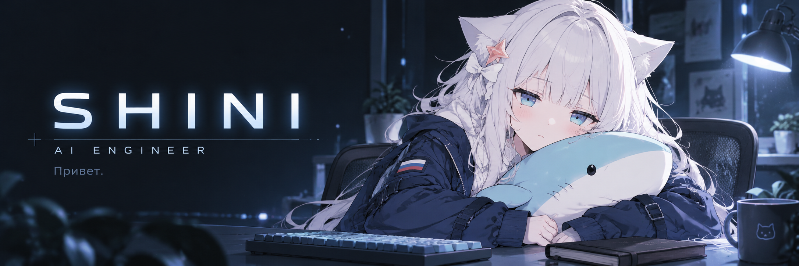

  

  <samp>RETRIEVAL · AGENTS · LLM SYSTEMS · AI SECURITY</samp> 
  Доверяй, но проверяй.

  <a href="#engineering">Engineering</a> &nbsp; / &nbsp;
  <a href="#toolbox">Toolbox</a> &nbsp; / &nbsp;
  <a href="#selected-work">Selected work</a> &nbsp; / &nbsp;
  <a href="#off-duty">Вне смены</a>

<table width="100%">
<tr>
<td width="76%" valign="middle">
<h3>Shini / AI Engineer &amp; Tech Lead</h3>

I work on agents, retrieval and the platform around them. C/Assembly, embedded systems and automation were my starting point. My work now spans model integration, shared backend services and hybrid Azure/GCP environments.

<strong>I put LLMs in production. I still don't trust them.</strong>

</td>
<td width="24%" align="center" valign="middle">

 Всё под контролем. Probably.
</td>
</tr>
</table>

## Engineering

01 / TECHNICAL FOCUS — WHAT I PAY ATTENTION TO

<table width="100%">
<tr>
<td width="50%" valign="top">
01.1 / RETRIEVAL
<h3>Advanced RAG</h3>

Hybrid search, reranking, evidence selection and semantic caching. Document structure and provenance before index tuning.

<code>Recall@k</code> · <code>MRR</code> · <code>grounding</code> · <code>abstention</code>

</td>
<td width="50%" valign="top">
01.2 / ORCHESTRATION
<h3>Agentic systems</h3>

Explicit graph state, typed tools and bounded planning loops. Checkpoints, idempotent actions and a stopping condition.

<code>state</code> · <code>tool contracts</code> · <code>permissions</code>

</td>
</tr>
<tr>
<td width="50%" valign="top">
01.3 / MODEL SYSTEMS
<h3>LLM engineering</h3>

Validated outputs, prompt and model versioning, regression datasets and provider fallbacks. Quality, latency and cost in the same release decision.

<code>evals</code> · <code>tracing</code> · <code>fallbacks</code>

</td>
<td width="50%" valign="top">
01.4 / TRUST BOUNDARIES
<h3>AI security engineering</h3>

Prompt injection, retrieval-based exfiltration, tool abuse and cross-tenant access. Scoped credentials and repeatable adversarial tests.

<code>authorization</code> · <code>isolation</code> · <code>red teaming</code>

</td>
</tr>
</table>

<strong>Open the design notes</strong> — retrieval, execution and security

### Retrieval & evidence

Parsing, chunking and provenance are separate stages. Evaluate retrieval and generation independently; inspect evidence and citation grounding, including queries that should produce an abstention.

### Agent execution

Tool contracts define what an agent can do. State, checkpoints, idempotency and approval boundaries define what happens when execution fails or crosses into an external system.

### LLM releases

Version prompts, models and evaluation datasets together. Compare quality, latency and inference cost before promotion; keep a fallback and a rollback path.

### Security boundaries

Apply authorization at retrieval and tool boundaries. Treat retrieved content and tool output as untrusted input. Handle sensitive data in traces deliberately and turn abuse cases into repeatable tests.

## Toolbox

02 / APPLICATIONS → PLATFORM → OPERATIONS

| Layer | Stack |
| :--- | :--- |
| **Application & systems** | Python · FastAPI · TypeScript · C/Assembly |
| **AI & retrieval** | LangChain / LangGraph · PyTorch · Vertex AI · PostgreSQL / pgvector · BM25 · reranking |
| **Cloud & platform** | GCP · GKE / Kubernetes · Azure · Docker · Secret Manager |
| **Data & messaging** | PostgreSQL · Kafka |
| **Evaluation & delivery** | OpenTelemetry · regression evaluations · shadow mode · Azure DevOps |

Digging deeper: C++ · inference serving · durable agent execution.

## Selected work

03 / READ THE CODE, CHECK THE TRADE-OFFS

<table width="100%">
<tr>
<td width="50%" valign="top">
AGENTIC RETRIEVAL
<h3><a href="https://github.com/CallmeShini/nextjs-docs-rag">nextjs-docs-rag ↗</a></h3>

Agentic retrieval over Next.js documentation: hybrid search, local reranking, evidence memory and semantic caching.

<strong>Inspect:</strong> explicit orchestration and reproducible cold/warm benchmarks.

</td>
<td width="50%" valign="top">
GROUNDED DOCUMENTATION QA
<h3><a href="https://github.com/CallmeShini/docsrag-observatory">docsrag-observatory ↗</a></h3>

Documentation QA with a deterministic data pipeline, explicit abstention and separate evaluation of retrieval and generation.

<strong>Inspect:</strong> provenance, answer gating and evaluation-driven iteration.

</td>
</tr>
</table>

## Off duty

<strong>За кулисами</strong> / behind the scenes

Меньше суеты. Больше работающего кода. 
Акула отвечает за моральную поддержку. За код отвечаю я.

  На связи. / The shark is emotional support. I review the code. 
  GIF: <a href="https://giphy.com/gifs/sad-gawr-gura-absurdexcrod-FN6731cXHeb7VJCkly">Nosenzei via GIPHY</a>

